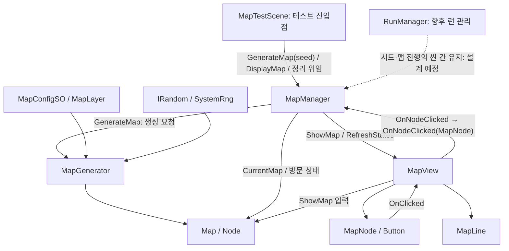

# Project Atelier — Architecture Map

> 마지막 갱신: 2026-10-28. 관련 작업 트리 소스 확인(조회 HEAD: a2bfaec, 미커밋 변경 포함).
> 현재 구현과 승인된 향후 구조를 구분한다.
> AI는 실행 검증을 수행하지 않았다. 재표시·정리 안정화는 개발자 테스트 보고상 문제없다.
> 위 보고는 2026-10-26 이관 전 구현에 해당한다. 10-28 책임 이관 후 실행 결과는 미보고다.

## 1. 코드와 어셈블리 경계

게임 코드:
- Assets/_Projects/Scripts/.
- 별도 asmdef 없음, 전역 네임스페이스 사용.
- Map, Random, System, Utils 디렉터리로 구성.

자체 제작 프레임워크:
- 실제 패키지 경로: Packages/urdev-game-framework/.
- 패키지 ID/버전: com.urdev.game-framework / 0.1.0.
- 승인된 통일 명칭: URDev.GameFramework (2026-10-22 개발자 정정).
- 현재 asmdef 이름/rootNamespace: URDev.GameFramework.
- 대부분의 현재 런타임 타입: URDev.GameFramework.
- Runtime/Framework.cs: URDev.GameFramework (개발자 변경 후 소스 확인).
- 승인 명칭과 확인한 asmdef/Framework.cs 식별자가 일치한다. 이번 갱신은 문서만 변경한다.

근거:
- Packages/urdev-game-framework/Runtime/URDev.GameFramework.asmdef.
- Packages/urdev-game-framework/Runtime/Framework.cs.
- Packages/urdev-game-framework/package.json.

asmdef는 autoReferenced=true이며 GUID 참조 한 개가 있다.
GUID의 실제 대상은 허용된 탐색 범위에서 확정하지 않았다.
소스의 Input System/uGUI 사용은 확인했으나 package.json dependencies는 비어 있다.
현재 호스트의 패키지 설치와 독립 재사용 시 의존성 계약을 구분한다.

게임 → 프레임워크 참조는 확인된다.
프레임워크 → 게임 타입의 역참조는 발견하지 못했다.
서비스 간 Managers 접근은 객체 결합이며 어셈블리 순환 참조와 다르다.

## 2. 핵심 시스템

| 영역 | 타입 | 실제 책임 | 근거 |
| --- | --- | --- | --- |
| 맵 모델 | Map, Node | 노드, ID 조회, 좌표와 전후 연결 | Assets/_Projects/Scripts/Map/Map.cs, Node.cs |
| 작성 설정 | MapConfigSO, MapLayer, MapNodeSO | 레이어·범위·아이콘 매핑 | Assets/_Projects/Scripts/Map/MapConfigSO.cs, MapLayer.cs, MapNodeSO.cs |
| 생성 | MapGenerator | 노드 배치, 경로 생성, 좌표 변동, 교차 제거 | Assets/_Projects/Scripts/Map/MapGenerator.cs |
| 맵 제어·진행 | MapManager | 생성 요청, 현재 맵·진행, 이동 판정, 클릭 수신, 표시·정리 조정 | Assets/_Projects/Scripts/Map/MapManager.cs |
| 표시 | MapView, MapNode, MapLine | uGUI 표시와 클릭 전달 | Assets/_Projects/Scripts/Map/MapView.cs, MapNode.cs, MapLine.cs |
| 난수 | IRandom, SystemRng | 난수 구현 주입 | Assets/_Projects/Scripts/Random/ |
| 현재 시드 코드 | RuntimeManager | Seed/Random 보관, MapManager 기본 RNG 참조 존재, 등록 연결 없음 | Assets/_Projects/Scripts/System/RuntimeManager.cs |
| 테스트 진입점 | MapTestScene | 시작·수동 테스트 호출, 시드 전달, 씬 정리 위임 | Assets/_Projects/Scripts/Map/Test/MapTestScene.cs |
| 향후 런 관리 | RunManager | IGameSystem 골격만 존재, 런 상태 소유·생성/초기화 연결 없음 | Assets/_Projects/Scripts/System/RunManager.cs, ADR-003 |

Map/Node는 MonoBehaviour가 아닌 일반 C# 객체지만 Vector2 등
Unity 타입에 의존하므로 완전히 엔진 독립적인 모델은 아니다.

## 3. 공용 프레임워크

아래 경로의 기준은 Packages/urdev-game-framework/Runtime/Scripts/다.

| 시스템 | 책임 | 기준 경로 아래 파일 |
| --- | --- | --- |
| Managers | 기본 서비스 소유, 등록, Init/Tick/Clear | Core/Bootstrap/Managers.cs |
| MonoBehaviourSingleton | 탐색·지연 생성·영속화 | Core/Common/MonoBehaviourSingleton.cs |
| IGameSystem/IUpdatableSystem | Init/Clear 및 Tick 계약 | Core/Lifecycle/IGameSystem.cs |
| ResourceManager/IAssetProvider | Resources 로딩·생성·파괴 | Systems/Resources/ResourceManager.cs |
| PoolManager/PoolableObject | 이름 기반 풀 대여·반환 | Systems/Pooling/ |
| SoundManager | BGM/SFX AudioSource와 클립 캐시 | Systems/Sound/SoundManager.cs |
| DataManager/IDictable | JSON 로딩과 키·타입별 테이블 | Systems/Data/DataManager.cs |
| InputManager | Input System 키·마우스 폴링 | Systems/Input/InputManager.cs |
| SceneManagerEX/BaseScene | 씬 전환과 EventSystem 준비 | Systems/Scene/ |
| UIManager/UI_Base/UI_Scene/UI_Popup | UI 생성, 이름 바인딩, 팝업 스택 | Systems/UI/ |

관찰된 패턴은 Singleton, Service Locator 성격의 접근,
생명주기 인터페이스, 생성자 난수 주입, ScriptableObject 설정,
C# 이벤트, 공용 Object Pool이다. 패턴의 존재만으로 공식 채택 이유를 추정하지 않는다.

## 4. 초기화와 생명주기

### 현재 진입

BaseScene.Awake → MapTestScene.Init → BaseScene.Init.

- EventSystem이 없으면 Managers.Resource로 EventSystem 프리팹을 생성한다.
- Managers 접근이 Singleton 지연 생성·초기화로 이어질 수 있다.
- MapTestScene은 SceneName을 설정한다.
- MapManager.OnEnable/OnDisable이 View 클릭 이벤트를 구독·해제한다.
- Start → GenerateNewMap → MapManager.GenerateMap(_seed)이 생성기를 호출한다.
  생성 성공 시 private SetMap이 기존 맵·진행·표시를 Clear하고 새 맵을 설정한다.
  GenerateMap이 true를 반환한다.
  MapTestScene은 true일 때 DisplayMap(ShowMap → RefreshStates)을 호출한다.
- RedisplayCurrentMap은 DisplayMap을 호출하여 진행을 유지한다.
- MapTestScene.ClearDisplayedMap → MapManager.ClearDisplayedMap → MapView.Clear는 표시만 정리한다.
  세 확인용 ContextMenu 메서드는 Application.isPlaying으로 제한된다.
- MapTestScene.Clear → MapManager.Clear는 맵·현재 노드·방문 이력·표시를 초기화한다.
  Clear 자체는 View 클릭 구독을 해제하지 않는다.

### Managers

- 서비스 객체는 Managers 필드에서 생성한다.
- 기본 Init 순서: Resource → Sound → Pool → Data → Input → Scene → UI.
- Managers.Update는 IUpdatableSystem.Tick을 순회한다.
- 기본 서비스 중 InputManager가 Tick을 구현한다.
- RegisterSystem은 동일 인스턴스 중복만 방지한다.
- GetSystem은 첫 번째 타입 일치 시스템을 반환한다.
- Clear는 등록 역순 호출이며 등록 제거·자동 재초기화가 아니다.
- 기본 설정의 Managers와 별도 Sound/Pool 루트는 씬 간 유지된다.
- UI 루트와 표시 객체는 별도 영속화가 없는 씬 객체다.

### 현재와 향후 런 수명

- RuntimeManager.Init은 비어 있고 GenerateSeed가 RNG를 만든다.
- 등록 호출은 발견하지 못했다.
- 테스트 진입은 MapTestScene.Start → GenerateNewMap → MapManager.GenerateMap(_seed)이며,
  씬의 _seed 저장값은 40000이다. customSeed > 0이면 SystemRng(customSeed)를 사용한다.
- GenerateMap(int customSeed = 0)의 customSeed <= 0 경로는 RuntimeManager.Random을 참조한다.
  등록·RNG 초기화 호출은 발견하지 못했다. 미등록 시 .Random 접근에서 예외가 발생할 수 있다.
  생성기 생성 후의 null 검사는 이 접근을 보호하지 않으며, bool 반환이 모든 예외를 처리하지는 않는다.
- RunManager는 IGameSystem 골격이다. Init에서 자기 등록하고 Clear는 비어 있으며,
  생성·초기화 호출과 맵·시드·진행 소유는 발견하지 못했다.
- SceneManagerEX.LoadScene은 Managers.Clear를 먼저 호출한다.
- RuntimeManager.Clear는 Seed=0, Random=null로 만든다.

승인된 향후 구조:
- RunManager가 한 번의 런을 관리한다.
- 시드와 맵 진행은 씬 전환에도 유지해야 한다.
- 현재 전역 Clear 정책을 그대로 런 종료로 간주하면 안 된다.
- RunManager의 API, 등록 방식, RuntimeManager와의 관계는 아직 미정이다.
- MapManager의 현재 소유 상태가 이미 RunManager로 이전되었다고 설명하지 않는다.

## 5. 맵 생성·표시 흐름

실선은 구현된 메서드의 호출·데이터 의존성이다.
점선은 승인된 연결 방향이지만 아직 구현되지 않은 부분이다.
저장된 테스트 씬 참조도 확인했지만 실제 실행 성공을 검증한 것은 아니다.

### 생성기

GetMap:
1. 입력 설정 검증 후 내부 상태 초기화.
2. 레이어별 노드 배치.
3. 시작점과 종착점 직전 노드 선택·경로 생성.
4. 좌표 난수 변동.
5. 인접 격자의 교차 대각선 연결 제거.
6. 전후 연결이 있는 노드만 추린 뒤 ValidatePaths를 통과하면 Map에 전달.

승인된 규칙:
- 마지막 노드는 BossEnemy.
- 모든 시작점에서 종착점에 도달해야 한다.
- 막다른 길 금지.

2026-10-26 소스 확인:
- PlaceLayer는 마지막 레이어 타입을 BossEnemy로 강제한다.
- Vaildate(현재 소스의 철자)는 범위·레이어 수·간격·확률·참조·Boss 배치 제약 등을 검증한다.
- 교차 제거 후 ValidatePaths는 선택한 시작점/보스 직전 노드의 유지,
  최종 Boss, 비종착 노드의 막다른 길, 레이어 방향과 전후 연결 정합성 등을 검사한다.
- 실패 시 오류를 기록하고 null을 반환한다. 경로 자동 복구·재시도는 없다.
- MapManager.ValidateMapSeeds는 10,000회 생성의 예외/null 여부를 확인하는 Editor 진입점이다.
  여러 시드·설정의 실행 결과는 이번 재표시 테스트 보고로 확정하지 않는다.

### 진행과 입력

- private SetMap은 Clear로 기존 맵·진행·표시를 정리한 후 새 모델을 설정한다.
- 최초 방문은 Layer 0이며 다음 연결이 있는 노드에 허용한다.
- 이후 방문은 현재 노드의 NextNodeIds에 포함된 대상에 허용한다.
- TryVisitNode 성공 시 상태 갱신 → RefreshView → OnNodeSelected.
- OnNodeSelected의 콘텐츠 처리 구독자는 발견하지 못했다.

현재 이벤트:
Button.onClick → MapNode.OnClicked → MapView.OnNodeClicked →
MapManager.OnNodeClicked(MapNode) → MapManager.TryVisitNode(MapNode.Node.Id).

View 이벤트는 MapNode를 전달하며 MapManager가 ID로 변환한다.
MapManager는 OnEnable/OnDisable에서 구독·해제한다. Clear는 구독을 유지한다.
전역 Event Bus 구현은 발견하지 못했다.

### 표시와 재열기

- ShowMap은 Clear 후 노드·선을 Instantiate한다.
- 노드 위치 범위와 _unitsToPixels/_padding으로 content 크기와 표시 좌표를 계산한다.
  노드·선은 하단 중앙 anchor를 사용하며 현재 씬의 _unitsToPixels는 1이다.
- RefreshStates는 방문/방문 가능/잠김 노드 상태를 갱신한다.
- 방문 순서의 연속 ID 쌍을 방문 간선으로 기록하고,
  방문한 선·현재 노드에서 이동 가능한 선·잠긴 선의 색상을 갱신한다.
- _displayedMap과 다른 맵의 상태 갱신은 경고 후 거부한다.
- MapNode는 방문 가능 상태에서만 Button.interactable을 true로 설정하고 클릭 이벤트를 전달한다.
- MapNode는 Awake/OnDestroy에서 버튼 리스너를 등록·해제한다.
- MapLine은 Awake/SetData에서 Image.raycastTarget을 false로 설정한다.
- MapView.Clear는 노드 이벤트 구독 해제 후 노드·선을 비활성화하고 Destroy한다.
  컬렉션과 _displayedMap도 초기화한다. OnDestroy는 Clear와 외부 이벤트 정리를 수행한다.
- MapManager.ClearDisplayedMap은 표시만 정리하고 진행·클릭 구독을 유지한다.
  MapTestScene.Clear가 위임하는 MapManager.Clear는 진행까지 초기화하므로
  화면 정리 확인에는 사용하지 않는다. 클릭 구독 해제는 OnDisable에서 담당한다.
- 재표시·새 맵 생성·화면 비활성화/재활성화·정리 후 재표시는
  개발자가 수정 후 테스트 결과 문제없음을 보고했다(2026-10-26).
  세부 로그·반복 횟수는 제공되지 않았고, 씬 전환과 풀링은 별도 미완료 범위다.

승인된 목표는 맵 풀링을 통해 게임 중 현재 지도를 다시 여는 것이다.
현재 MapView에는 공용 풀 연결이 없다.
풀링 단위와 표시 객체 수명은 미정이며,
런 데이터 보존과 표시 객체 재사용을 별도 책임으로 설계해야 한다.

## 6. 씬과 작성 데이터

- 활성화된 빌드 씬: Assets/_Projects/Scenes/MapTestScene.unity.
- MapTestScene/MapManager/MapView 스크립트 GUID와 씬의 Config/Manager/View 참조를 확인했다.
- MapManager._config/_view 및 MapTestScene._mapManager가 연결되어 있다.
  MapTestScene 코드에서 제거한 _config/_mapView 항목은 씬 YAML에 남아 있으나 현재 사용하지 않는다.
- MapView에는 content, nodeRoot, lineRoot 및 노드·선 프리팹이 연결되어 있다.
- 프리팹: Assets/Resources/Prefabs/UI/Map/MapNode.prefab 및 MapLine.prefab.
  각 스크립트 GUID와 Image/Button 참조, View의 프리팹 GUID/fileID를 대조했다.
- NodeRoot와 LineRoot는 같은 부모 아래 동일한 저장 transform 값을 사용한다.
  화면상의 정렬과 입력 동작은 실행 미검증이다.
- EventSystem.prefab에는 EventSystem과 InputSystemUIInputModule이 있다.
- 씬의 m_EditorClassIdentifier에는 과거 RoguelikeTestScene 표기가 있지만
  m_Script GUID는 현재 MapTestScene.cs.meta와 일치한다.
  이것만으로 Missing Script나 게임 장르를 추정하지 않는다.

기존 씬 미연결 기록 이후 20b475d에서 테스트 연결이 구현되었다.
2026-10-28 생성·표시·클릭 연결 책임은 MapManager로 이전되었다.
MapTestScene은 테스트 호출을 담당한다. 런 상태 소유권·씬 수명 분리는 아직 미구현이다.

MapConfig.asset:
- 경로: Assets/Resources/ScriptableObject/Map/MapConfig.asset.
- 20b475d에서 이전 필드명이 numOfPreBossNodes/numOfStartingNodes/NodeApartDistance로
  갱신되어 현재 코드와 일치한다.
- 마지막 레이어는 NodeType=3(BossEnemy), randomNodeValue=0이다.
- MapNodeSO 참조 8개는 Assets/Resources/ScriptableObject/Map/Node/ 자산의 GUID와 일치한다.
- 현재 값은 개발자가 테스트에서 수정할 임시 데이터다.
  마지막 레이어 값 등을 제품 의도나 승인된 규칙으로 해석하지 않는다.
- 자산의 정적 정합성을 확인했으며 실제 로딩·표시 성공은 미검증이다.

## 7. 데이터와 저장

- 작성 데이터: MapConfigSO 자산 1개 및 MapNodeSO 자산 8개.
- 런타임 데이터: Map/Node, 현재 노드, 방문 이력.
- Node의 연결 목록은 외부에서 수정 가능한 List다.
- Map은 노드 목록을 복사하지만 Node 자체를 깊은 복사하지 않는다.
- Map.BossNodeName은 현재 초기화되지 않는다.
- DataManager는 Resources/Data JSON을 읽고 키·타입별 테이블을 등록한다.
- DataManager.Clear는 비어 있으며 영속 저장 구현이 아니다.
- 맵·시드·진행의 디스크 저장·복원은 발견하지 못했다.
- 씬 간 상태 유지 요구만으로 디스크 저장을 필수 범위에 추가하지 않는다.

## 8. 확장·품질 검토

장점:
- 모델·생성·진행·표시 책임 분리.
- IRandom 주입과 ID 기반 연결.
- 프레임워크와 게임 코드 경계.
- 기본 생명주기 및 UI 리스너 해제 지점 존재.

검토 대상:
- Managers를 통한 서비스 상호 접근과 수명 결합.
- Resource/Pool의 프리팹 이름 기반 키 충돌 가능성.
- UIManager의 생성 메서드에 UI_Base.Init 호출이 없음.
- InputManager의 Click은 실제 버튼 해제 판정이 아닌 분기에서 발생.
- 프레임워크 문서의 Packages/com.urdev.game-framework와 실제
  Packages/urdev-game-framework 경로 불일치. 승인된 namespace/asmdef 명칭은 일치한다.
- ResourceManager는 IAssetProvider를 구현하지만 현재 소비자는 Managers.Resource의
  구체 서비스에 접근한다. 인터페이스 존재와 교체 가능한 소비 구조를 구분한다.

할당·성능 관찰:
- ShowMap마다 전체 생성·파괴.
- RefreshStates는 필드 HashSet을 Clear하여 재사용한다. 용량 증가 시 할당 가능성은 별도다.
- VisitedNodeIds 접근 시 AsReadOnly 래퍼 생성.
- 생성·표시 과정의 LINQ와 임시 컬렉션.
- 일부 서비스의 씬 객체 검색.

실행 빈도와 규모를 측정하지 않았으므로 병목으로 단정하지 않는다.
풀링 방향은 개발자가 승인했지만 세부 최적화는 실제 테스트에 맞춘다.

자체 테스트 코드·테스트 asmdef는 발견하지 못했다.
MapTestScene은 자동화 테스트가 아니라 수동 확인용 씬 코드다.

## 9. 분석·제안 원칙

- 최신 소스와 실제 호출자·소유자·소비자를 함께 읽는다.
- 씬·프리팹 판단은 GUID와 직렬화 참조로 확인한다.
- 승인된 목표, 관찰된 구현, 미구현, 미검증을 구분한다.
- 실제 식별자를 목표 명칭으로 바꾸어 인용하지 않는다.
- 현재 화면 확인보다 앞서 불필요한 계층이나 전면 리팩터링을 요구하지 않는다.
- 기술 검토 시 수명, 이벤트, 입력, 직렬화, 할당, 테스트 가능성을 확인한다.
- 개인 Memo.md는 참고만 하며 현재 사용자 요구와 Accepted 결정을 우선한다.
- 생산 코드·자산 변경과 Unity 실행·검증은 개발자가 수행한다.
