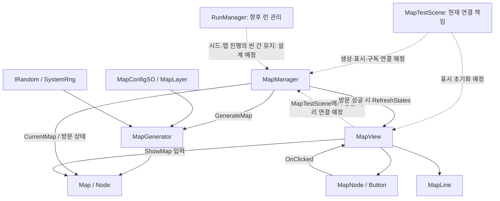

# Project Atelier — Architecture Map

> 마지막 갱신: 2026-10-22.
> 현재 구현과 승인된 향후 구조를 구분한다.
> 소스·설정·자산을 정적으로 분석했으며 실행 검증은 수행하지 않았다.

## 1. 코드와 어셈블리 경계

게임 코드:
- Assets/_Projects/Scripts/.
- 별도 asmdef 없음, 전역 네임스페이스 사용.
- Map, Random, System, Utils 디렉터리로 구성.

자체 제작 프레임워크:
- 실제 패키지 경로: Packages/urdev-game-framework/.
- 패키지 ID/버전: com.urdev.game-framework / 0.1.0.
- 승인된 통일 명칭: URDev.GameFrameWork.
- 현재 asmdef 이름/rootNamespace: URDev.GameFramework.
- 대부분의 현재 런타임 타입: URDev.GameFramework.
- Runtime/Framework.cs: UR.GameFramework.
- 이름 이전은 미완료이며 문서 갱신으로 코드가 변경되지는 않는다.

근거:
- Packages/urdev-game-framework/Runtime/URDev.GameFramework.asmdef.
- Packages/urdev-game-framework/Runtime/Framework.cs.
- Packages/urdev-game-framework/package.json.

asmdef는 autoReferenced=true이며 GUID 참조 한 개가 있다.
GUID의 실제 대상은 허용된 탐색 범위에서 확정하지 않았다.
소스의 Input System/uGUI 사용은 확인했으나 package.json dependencies는 비어 있다.
현재 호스트의 패키지 설치와 독립 재사용 시 의존성 계약을 구분한다.

게임 → 프레임워크 참조는 확인된다.
프레임워크 → 게임 타입의 역참조는 발견하지 못했다.
서비스 간 Managers 접근은 객체 결합이며 어셈블리 순환 참조와 다르다.

## 2. 핵심 시스템

| 영역 | 타입 | 실제 책임 | 근거 |
| --- | --- | --- | --- |
| 맵 모델 | Map, Node | 노드, ID 조회, 좌표와 전후 연결 | Assets/_Projects/Scripts/Map/Map.cs, Node.cs |
| 작성 설정 | MapConfigSO, MapLayer, MapNodeSO | 레이어·범위·아이콘 매핑 | Assets/_Projects/Scripts/Map/MapConfigSO.cs, MapLayer.cs, MapNodeSO.cs |
| 생성 | MapGenerator | 노드 배치, 경로 생성, 좌표 변동, 교차 제거 | Assets/_Projects/Scripts/Map/MapGenerator.cs |
| 진행 | MapManager | 현재 맵·노드·방문 이력과 이동 판정 | Assets/_Projects/Scripts/Map/MapManager.cs |
| 표시 | MapView, MapNode, MapLine | uGUI 표시와 클릭 전달 | Assets/_Projects/Scripts/Map/MapView.cs, MapNode.cs, MapLine.cs |
| 난수 | IRandom, SystemRng | 난수 구현 주입 | Assets/_Projects/Scripts/Random/ |
| 현재 시드 코드 | RuntimeManager | Seed/Random 보관, 등록 연결 없음 | Assets/_Projects/Scripts/System/RuntimeManager.cs |
| 현재 구성 지점 | MapTestScene | 맵 연결 책임을 맡기로 결정, 연결 코드는 아직 없음 | Assets/_Projects/Scripts/Map/Test/MapTestScene.cs |
| 향후 런 관리 | RunManager | 한 번의 런 관리 예정, 구현 없음 | 개발자 결정 ADR-003 |

Map/Node는 MonoBehaviour가 아닌 일반 C# 객체지만 Vector2 등
Unity 타입에 의존하므로 완전히 엔진 독립적인 모델은 아니다.

## 3. 공용 프레임워크

아래 경로의 기준은 Packages/urdev-game-framework/Runtime/Scripts/다.

| 시스템 | 책임 | 기준 경로 아래 파일 |
| --- | --- | --- |
| Managers | 기본 서비스 소유, 등록, Init/Tick/Clear | Core/Bootstrap/Managers.cs |
| MonoBehaviourSingleton | 탐색·지연 생성·영속화 | Core/Common/MonoBehaviourSingleton.cs |
| IGameSystem/IUpdatableSystem | Init/Clear 및 Tick 계약 | Core/Lifecycle/IGameSystem.cs |
| ResourceManager/IAssetProvider | Resources 로딩·생성·파괴 | Systems/Resources/ResourceManager.cs |
| PoolManager/PoolableObject | 이름 기반 풀 대여·반환 | Systems/Pooling/ |
| SoundManager | BGM/SFX AudioSource와 클립 캐시 | Systems/Sound/SoundManager.cs |
| DataManager/IDictable | JSON 로딩과 키·타입별 테이블 | Systems/Data/DataManager.cs |
| InputManager | Input System 키·마우스 폴링 | Systems/Input/InputManager.cs |
| SceneManagerEX/BaseScene | 씬 전환과 EventSystem 준비 | Systems/Scene/ |
| UIManager/UI_Base/UI_Scene/UI_Popup | UI 생성, 이름 바인딩, 팝업 스택 | Systems/UI/ |

관찰된 패턴은 Singleton, Service Locator 성격의 접근,
생명주기 인터페이스, 생성자 난수 주입, ScriptableObject 설정,
C# 이벤트, 공용 Object Pool이다. 패턴의 존재만으로 공식 채택 이유를 추정하지 않는다.

## 4. 초기화와 생명주기

### 현재 진입

BaseScene.Awake → MapTestScene.Init → BaseScene.Init.

- EventSystem이 없으면 Managers.Resource로 EventSystem 프리팹을 생성한다.
- Managers 접근이 Singleton 지연 생성·초기화로 이어질 수 있다.
- MapTestScene은 SceneName을 설정한다.
- MapTestScene.Start/Clear는 현재 비어 있다.

### Managers

- 서비스 객체는 Managers 필드에서 생성한다.
- 기본 Init 순서: Resource → Sound → Pool → Data → Input → Scene → UI.
- Managers.Update는 IUpdatableSystem.Tick을 순회한다.
- 기본 서비스 중 InputManager가 Tick을 구현한다.
- RegisterSystem은 동일 인스턴스 중복만 방지한다.
- GetSystem은 첫 번째 타입 일치 시스템을 반환한다.
- Clear는 등록 역순 호출이며 등록 제거·자동 재초기화가 아니다.
- 기본 설정의 Managers와 별도 Sound/Pool 루트는 씬 간 유지된다.
- UI 루트와 표시 객체는 별도 영속화가 없는 씬 객체다.

### 현재와 향후 런 수명

- RuntimeManager.Init은 비어 있고 GenerateSeed가 RNG를 만든다.
- 등록 호출은 발견하지 못했다.
- MapManager.GenerateMap은 고정 시드 12345를 사용한다.
- SceneManagerEX.LoadScene은 Managers.Clear를 먼저 호출한다.
- RuntimeManager.Clear는 Seed=0, Random=null로 만든다.

승인된 향후 구조:
- RunManager가 한 번의 런을 관리한다.
- 시드와 맵 진행은 씬 전환에도 유지해야 한다.
- 현재 전역 Clear 정책을 그대로 런 종료로 간주하면 안 된다.
- RunManager의 API, 등록 방식, RuntimeManager와의 관계는 아직 미정이다.
- MapManager의 현재 소유 상태가 이미 RunManager로 이전되었다고 설명하지 않는다.

## 5. 맵 생성·표시 흐름

실선은 구현된 메서드의 호출·데이터 의존성이다.
점선은 승인된 연결 방향이지만 아직 구현되지 않은 부분이다.
메서드 존재가 현재 씬에서의 실행을 뜻하지 않는다.

### 생성기

GetMap:
1. 내부 상태 초기화.
2. 레이어별 노드 배치.
3. 시작점과 종착점 직전 노드 선택·경로 생성.
4. 좌표 난수 변동.
5. 인접 격자의 교차 대각선 연결 제거.
6. 전후 연결이 있는 노드만 Map에 전달.

승인된 규칙:
- 마지막 노드는 BossEnemy.
- 모든 시작점에서 종착점에 도달해야 한다.
- 막다른 길 금지.

현재 확인할 차이:
- 마지막 레이어를 종착점으로 선택하지만 BossEnemy를 강제하지 않는다.
- 교차 연결 제거 뒤 도달 가능성 검증·보정이 없다.
- 연결 하나 이상인 노드 필터는 종착점 도달 보장이 아니다.
- 빈 레이어·잘못된 범위·0개 시작점·빈 경로 후보 검증이 부족하다.
- 필수 규칙 충족은 아직 실행 검증하지 않았다.

### 진행과 입력

- SetMap은 모델 교체와 방문 상태 초기화만 한다.
- 최초 방문은 Layer 0이며 다음 연결이 있는 노드에 허용한다.
- 이후 방문은 현재 노드의 NextNodeIds에 포함된 대상에 허용한다.
- TryVisitNode 성공 시 상태 갱신 → RefreshView → OnNodeSelected.
- OnNodeSelected의 콘텐츠 처리 구독자는 발견하지 못했다.

현재 이벤트:
Button.onClick → MapNode.OnClicked → MapView.OnNodeClicked.

View 이벤트는 MapNode를 전달하지만 Manager의 private 핸들러는 int를 받는다.
MapTestScene 연결 시 Node.Id 전달과 구독·해제 수명을 정해야 한다.
전역 Event Bus 구현은 발견하지 못했다.

### 표시와 재열기

- ShowMap은 Clear 후 노드·선을 Instantiate한다.
- RefreshStates는 방문/방문 가능/잠김 노드 상태를 갱신한다.
- 선의 방문 경로 상태 갱신은 없으며 _lineActiveColor는 사용되지 않는다.
- MapNode는 Awake/OnDestroy에서 버튼 리스너를 등록·해제한다.
- MapView.Clear는 노드 이벤트 구독 해제 후 노드·선을 Destroy한다.

승인된 목표는 맵 풀링을 통해 게임 중 현재 지도를 다시 여는 것이다.
현재 MapView에는 공용 풀 연결이 없다.
풀링 단위와 표시 객체 수명은 미정이며,
런 데이터 보존과 표시 객체 재사용을 별도 책임으로 설계해야 한다.

## 6. 씬과 작성 데이터

- 활성화된 빌드 씬: Assets/_Projects/Scenes/MapTestScene.unity.
- MapTestScene 스크립트 GUID는 연결되어 있다.
- MapManager/MapView/MapNode/MapLine 컴포넌트 참조는 없다.
- MapNode 이름의 오브젝트는 정적인 Image UI다.
- 맵 노드·선 프리팹은 발견하지 못했다.
- EventSystem.prefab에는 EventSystem과 InputSystemUIInputModule이 있다.
- 씬의 m_EditorClassIdentifier에는 과거 RoguelikeTestScene 표기가 있지만
  m_Script GUID는 현재 MapTestScene.cs.meta와 일치한다.
  이것만으로 Missing Script나 게임 장르를 추정하지 않는다.

씬 미연결은 개발자가 확인한 현재 단계다.
MapTestScene에서 테스트 연결 후 다른 위치로 이전하며 목적지는 미정이다.

MapConfig.asset:
- 경로: Assets/Resources/ScriptableObject/Map/MapConfig.asset.
- 이전 필드명 prevBossNodeCount/nextStartNodeCount/NodeDistance가 남아 있다.
- 현재 코드 필드는 numOfPreBossNodes/numOfStartingNodes/NodeApartDistance다.
- 해당 필드에 FormerlySerializedAs 매핑을 발견하지 못했다.
- 현재 값은 개발자가 테스트에서 수정할 임시 데이터다.
  마지막 레이어 값 등을 제품 의도나 승인된 규칙으로 해석하지 않는다.
- 테스트에 사용하기 전에 현재 코드와 설정을 일치시켜야 한다.

## 7. 데이터와 저장

- 작성 데이터: MapConfigSO 및 MapNodeSO 자산 8개.
- 런타임 데이터: Map/Node, 현재 노드, 방문 이력.
- Node의 연결 목록은 외부에서 수정 가능한 List다.
- Map은 노드 목록을 복사하지만 Node 자체를 깊은 복사하지 않는다.
- Map.BossNodeName은 현재 초기화되지 않는다.
- DataManager는 Resources/Data JSON을 읽고 키·타입별 테이블을 등록한다.
- DataManager.Clear는 비어 있으며 영속 저장 구현이 아니다.
- 맵·시드·진행의 디스크 저장·복원은 발견하지 못했다.
- 씬 간 상태 유지 요구만으로 디스크 저장을 필수 범위에 추가하지 않는다.

## 8. 확장·품질 검토

장점:
- 모델·생성·진행·표시 책임 분리.
- IRandom 주입과 ID 기반 연결.
- 프레임워크와 게임 코드 경계.
- 기본 생명주기 및 UI 리스너 해제 지점 존재.

검토 대상:
- Managers를 통한 서비스 상호 접근과 수명 결합.
- Resource/Pool의 프리팹 이름 기반 키 충돌 가능성.
- UIManager의 생성 메서드에 UI_Base.Init 호출이 없음.
- InputManager의 Click은 실제 버튼 해제 판정이 아닌 분기에서 발생.
- 프레임워크 문서와 코드의 이름·패키지 경로 불일치.
- 선언만 존재하는 IAssetProvider와 실제 구체 서비스 소비의 차이.

할당·성능 관찰:
- ShowMap마다 전체 생성·파괴.
- RefreshStates마다 HashSet 생성.
- VisitedNodeIds 접근 시 AsReadOnly 래퍼 생성.
- 생성·표시 과정의 LINQ와 임시 컬렉션.
- 일부 서비스의 씬 객체 검색.

실행 빈도와 규모를 측정하지 않았으므로 병목으로 단정하지 않는다.
풀링 방향은 개발자가 승인했지만 세부 최적화는 실제 테스트에 맞춘다.

자체 테스트 코드·테스트 asmdef는 발견하지 못했다.
MapTestScene은 자동화 테스트가 아니라 수동 확인용 씬 코드다.

## 9. 분석·제안 원칙

- 최신 소스와 실제 호출자·소유자·소비자를 함께 읽는다.
- 씬·프리팹 판단은 GUID와 직렬화 참조로 확인한다.
- 승인된 목표, 관찰된 구현, 미구현, 미검증을 구분한다.
- 실제 식별자를 목표 명칭으로 바꾸어 인용하지 않는다.
- 현재 화면 확인보다 앞서 불필요한 계층이나 전면 리팩터링을 요구하지 않는다.
- 기술 검토 시 수명, 이벤트, 입력, 직렬화, 할당, 테스트 가능성을 확인한다.
- 개인 Memo.md는 참고만 하며 현재 사용자 요구와 Accepted 결정을 우선한다.
- 생산 코드·자산 변경과 Unity 실행·검증은 개발자가 수행한다.
